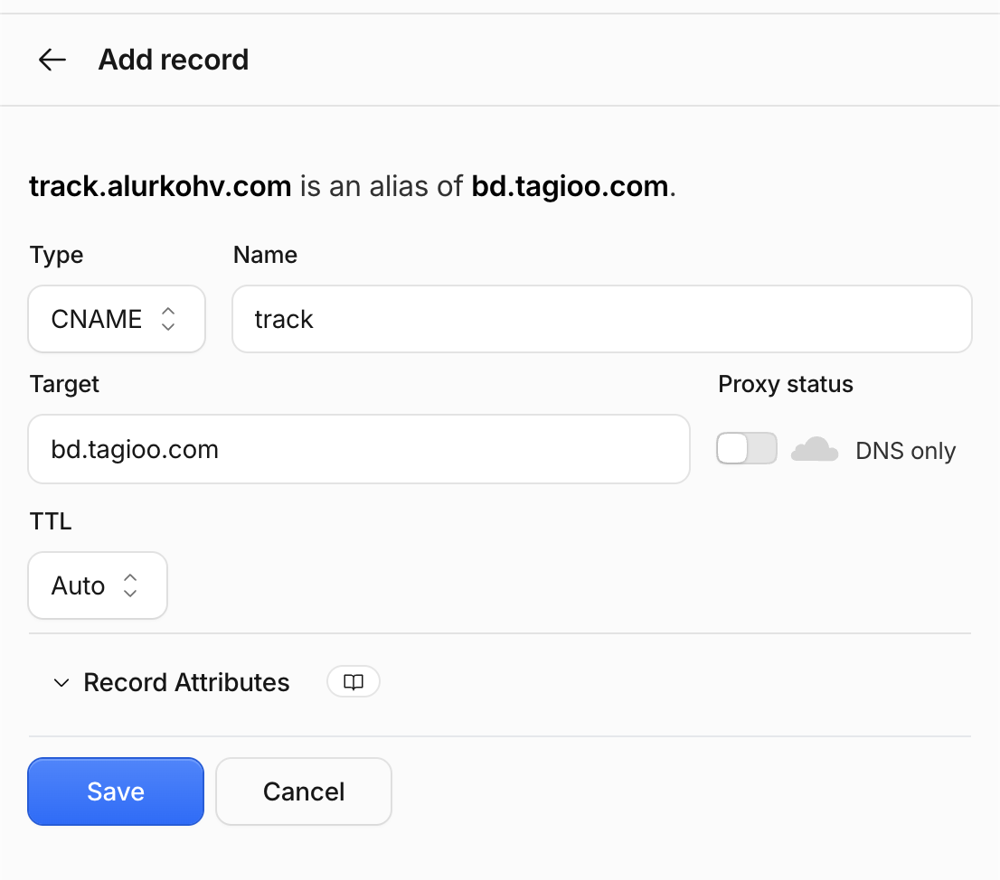
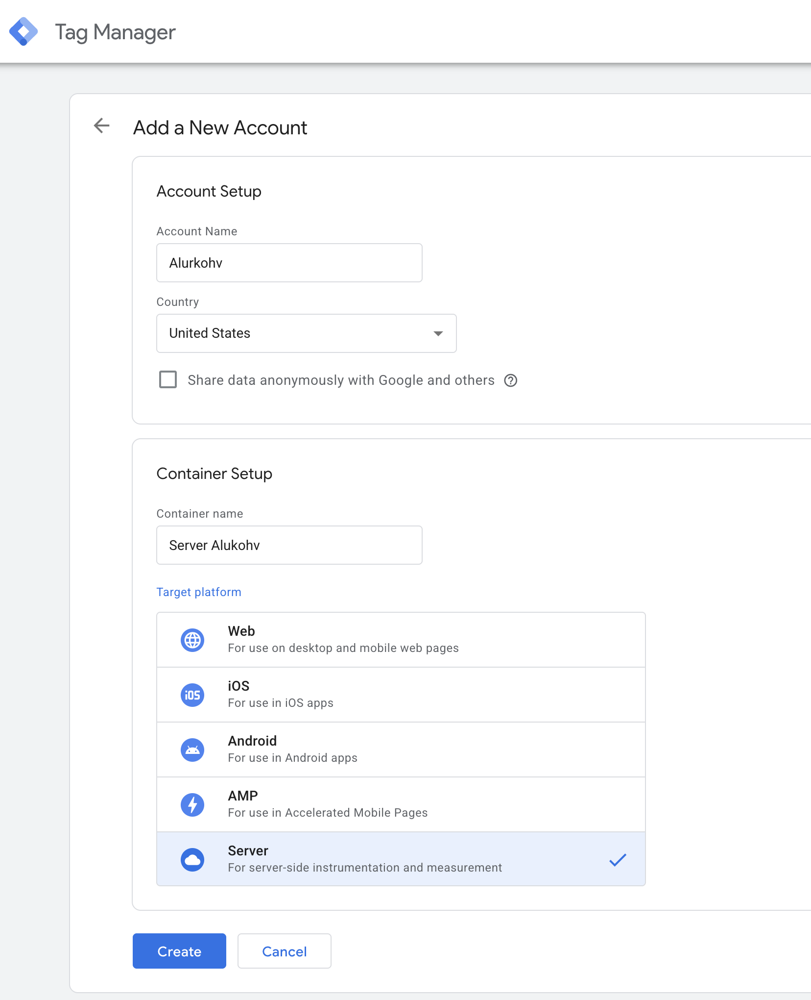
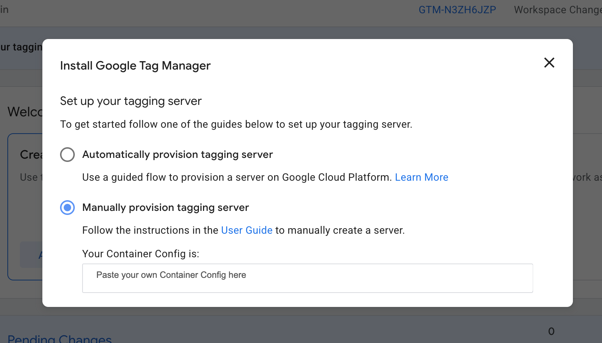
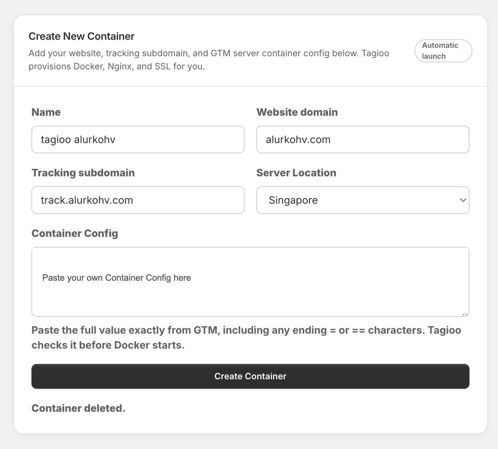
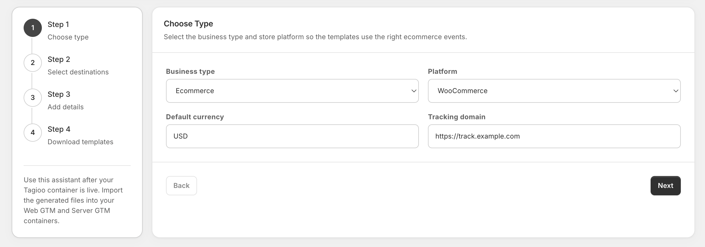
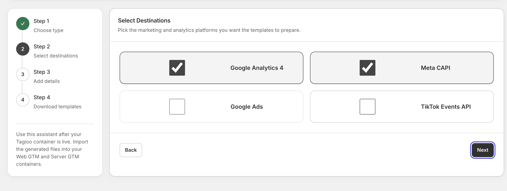
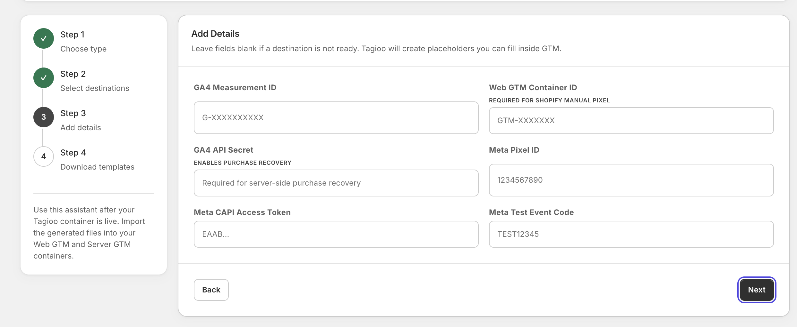
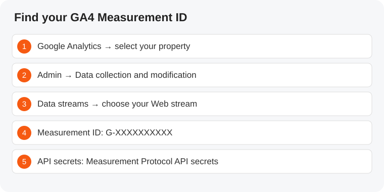

# Create your container and connect your website

Follow this guide before sending live tracking data. The screenshots below show an example store. Use your own domain, account and IDs. Container Config values have been hidden; copy your own value from GTM.

## Before you start — create the accounts you need

If you already have these accounts, use your existing ones. If another person manages them, ask for access to the correct website property and containers.

### Google account

Sign in with your Google account. If you do not have one, [create a Google account](https://accounts.google.com/signup) first. The same sign-in works for Analytics and Tag Manager, but each service still needs its own setup.

### Google Tag Manager account

1. Go to [Google Tag Manager](https://tagmanager.google.com), sign in and click **Create Account**.

1. Enter your business/account name and country. Create a container for your website; choose **Server** for the container Tagioo will host, and accept the terms.

1. Create a separate **Web** container when your platform instructions require web.json. In the same account, use Admin → Create Container and choose Web.
**Keep the two containers separate:** import server.json into Server and web.json into Web. Container Config is the long provisioning value; `GTM-` is a container ID.
### Google Analytics account and GA4 property

1. Go to [Google Analytics](https://analytics.google.com) and click **Start measuring**. If Analytics is already open, use Admin → Create → Account to create another account only when needed.

1. Name the account, review data-sharing settings, and click Next.

1. Create a GA4 property for your website. Choose its reporting time zone and actual reporting currency, complete the business details and accept the terms.

1. Choose **Web** as your data source, enter your website URL and stream name, and click **Create stream**.

1. Copy the stream’s **G- Measurement ID**. Keep it ready for Setup Guide Step 3.

[Official Google Analytics account and stream setup instructions](https://support.google.com/analytics/answer/9304153).

## 1. Prepare a first-party tracking subdomain

A first-party address belongs to your website domain: for `example.com`, use `track.example.com`. You do not need to buy a second domain.

1. Open the DNS provider for your website and add a CNAME record.

1. Use **track** as the name/host (some providers ask for the full `track.example.com`).

1. Set **Target = bd.tagioo.com**. This points `track.example.com` to Tagioo using a **CNAME**, not an A record.

1. Set **Proxy status = DNS only** (grey cloud), and **TTL = Auto**.

1. Click **Save**. The saved record should show CNAME, name `track`, target `bd.tagioo.com` and DNS only. Allow DNS to propagate; avoid another record at the same name.

The screenshot uses `track.alurkohv.com`; for your website use `track.example.com` with your actual domain.

**Before creating the Tagioo container:** CNAME track → bd.tagioo.com, DNS only, TTL Auto, then **Save**. Use the same tracking subdomain throughout setup.
## 2. Find your Server GTM Container Config

1. Go to **tagmanager.google.com**. Choose **Create Account** if you do not have an account; otherwise create a new container within your account.

1. Enter your account name and actual country. Give the container a name, select **Server** under Target platform, then click **Create** and accept the terms.

1. In the Server workspace click the container ID at the top right. Select **Manually provision tagging server**.

1. Copy the entire **Container Config** string, including ending `=` characters. This is not the GTM container ID and not an exported JSON template.

Click the copy icon beside **Your Container Config is**. Use your own complete value.

Keep the configuration private. [Google’s manual provisioning instructions](https://developers.google.com/tag-platform/tag-manager/server-side/manual-setup-guide).

## 3. Create the container in Tagioo

1. Go to **Containers → New Container**. Free and Starter include one container; upgrade if you already have one.

1. Enter a name, website URL, tracking subdomain and available server location. Paste the Server GTM Container Config.

1. Choose **Create Container**. Wait for provisioning, DNS and HTTPS checks to finish. If launch fails, read the status/error before retrying.

1. In Server GTM → Admin → Container Settings, set the server container URL to `https://track.example.com`.

This screenshot shows an example form, not a successful launch. “Container deleted” is an old status message; after creating yours, wait for its live/ready status.

## 4. Go to Setup Guide Menu

Once the container is ready, select that container and **go to Setup Guide Menu** in the dashboard sidebar. Complete the following steps one by one.

### Step 1 — Choose type

1. Choose your business type (for example **Ecommerce**).

1. Select your platform: WooCommerce, Shopify, Laravel or the matching option.

1. Default currency is **USD**. Change it to the currency your store charges; this does not convert order amounts.

1. Enter **https://track.example.com**, replacing example.com with your website domain. Use the same tracking subdomain you created.

1. Click **Next**.

### Step 2 — Select destinations

1. Select the services you want to send events to: GA4, Meta CAPI, Google Ads and/or TikTok Events API.

1. Select only the destinations you plan to configure, then click **Next**.

### Step 3 — Add details

1. Open Google Analytics and select your property. Go to **Admin → Data collection and modification → Data streams → your Web stream**. Copy the **Measurement ID** starting with `G-`; paste it into GA4 Measurement ID.

1. For purchase recovery, open **Measurement Protocol API secrets** in the same Web stream, create/copy a secret and enter it in GA4 API Secret.

1. For Meta, enter the dataset/pixel ID and Conversions API token from Events Manager. Use the Test Events code during testing, then remove it for normal reporting. Keep tokens private.

1. For Shopify manual pixel setup, enter your **Web** GTM ID (`GTM-`). This field is hidden for WooCommerce; enter that ID later in WordPress → WooCommerce → Tagioo.

1. Complete fields for any other selected destinations. If you leave credentials blank, fill their generated placeholders in GTM before publishing.

1. Click **Next**.

### **Meta Dataset / Pixel ID and Meta CAPI Access Token**

**Dataset / Pixel ID:** Events Manager → Data sources / Datasets → your website dataset → Settings → copy Dataset ID / Pixel ID.

**Meta CAPI Access Token:** same dataset → Settings → Conversions API → manual setup → Generate access token.

**Use the same dataset for both values.**

1. Open [Meta Events Manager](https://business.facebook.com/events_manager). Select the correct business portfolio.

1. Open **Data sources** (some accounts show **Datasets**) and select the website’s pixel/dataset.

1. Open its **Settings** tab. Find and copy the numeric **Dataset ID** or **Pixel ID**. For the website pixel’s dataset, paste that value into Tagioo’s **Meta Pixel ID** field.

1. In the same source’s Settings, locate **Conversions API**, choose the manual setup option if offered, and **Generate access token**. Paste the token into Meta CAPI Access Token. You need the appropriate management permissions; ask your business admin if the option is unavailable.

1. Open the same source’s **Test events** tab. **Meta Test Event Code is optional.** Copy it into Tagioo only for verification, then remove it when testing is finished.

### No Meta pixel or dataset yet?

1. Create/access your business portfolio in [Meta Business Suite](https://business.facebook.com).

1. In Events Manager choose **Connect data → Web** and follow the prompts to create/name a website dataset or pixel. Labels vary by account.

1. Return to that source’s Settings to copy its ID and configure Conversions API.
**Use the website’s Pixel/Dataset ID.** It is not your ad account ID, Facebook Page ID or business portfolio ID. **Keep the CAPI access token and GA4 API secret private.** The ID and token must belong to the same data source.

The supplied screenshot is from the earlier interface: Web GTM Container ID now appears only when Shopify is selected.

[Google Analytics Web stream instructions](https://support.google.com/analytics/answer/9304153).

**Check before continuing:** the GA4 Measurement ID starts with `G-`; your tracking URL starts with `https://`; currency matches your store. Fill blank credential placeholders before publishing.

### Step 4 — Download and import templates

1. Click **Generate templates** in Tagioo.

1. Download **web.json** and **server.json** to your computer. Keep the files as JSON.

1. For WooCommerce, click **Download WooCommerce plugin** immediately below the template buttons. Install it after importing the templates, as described below.

### Import web.json into your Web GTM container

1. Go to [Google Tag Manager](https://tagmanager.google.com) and select your website’s **Web** container. If you do not have one, use Admin → Create Container and choose Web.

1. Click **Admin → Import Container**.

1. Click **Choose container file** and select **web.json** from Downloads.

1. Under **Choose workspace**, select **Existing** and choose your workspace (usually Default Workspace). You can choose New if you want a separate workspace for these changes.

1. Select **Merge**. Review the conflict option: overwrite conflicting items only when you intend to update those existing items. Renaming preserves the old items but can leave duplicate tracking tags, so review both before publishing.

1. Click **Continue → View Detailed Changes**. Review the tags, triggers and variables being added or changed, then click **Confirm**.
**Choose Merge, not the top-level Overwrite option.** Top-level Overwrite replaces the container’s existing configuration. The separate “overwrite conflicting” option under Merge only updates matching conflicting items.
### Import server.json into your Server GTM container

1. Return to the container list and open the **Server** container whose Container Config you used in Tagioo.

1. Click **Admin → Import Container → Choose container file**, then select **server.json**.

1. Choose your Existing workspace, select **Merge**, review conflicts and click **Continue**.

1. Check **View Detailed Changes**, then click **Confirm**.

### Review, test and publish

1. In each imported container, review the destination IDs, credentials and tracking URL. Replace any placeholders left by blank assistant fields.

1. Install the platform integration described below. Use **Preview** to check that the intended events and tags fire; review existing tags so the same event is not sent twice.

1. When ready, click **Submit** at the top right of the Web container. Choose **Publish and Create Version**, give the version a clear name, review changes and click **Publish**.

1. Repeat Submit → Publish for the **Server** container. If you lack Publish access, ask the container administrator to publish the reviewed changes.

1. Verify a purchase using the final checklist below. Importing a file saves workspace changes; it does not publish them.

[Google’s container import instructions](https://support.google.com/tagmanager/answer/6106997) · [Google’s publishing instructions](https://support.google.com/tagmanager/answer/6107163).

**Shopify app path:** import server.json only; follow the Shopify section below rather than installing the manual Web tags as well.

## 5A. WooCommerce

1. Select WooCommerce, complete destination details, and generate/download **web.json** and **server.json**.

1. Download the Tagioo WooCommerce plugin directly below the template buttons. In WordPress → Plugins → Add New → Upload Plugin, upload `tagioo-woocommerce.zip`, install and activate.

1. Import web.json into a **Web** GTM container and server.json into your **Server** GTM container: Admin → Import Container → Existing workspace → Merge. Review conflicts before accepting. Fill remaining placeholders and publish both containers.

1. In WordPress → **WooCommerce → Tagioo**, enter the Web GTM container ID (`GTM-`), sGTM URL, GA4 Measurement ID and GA4 API secret. Enable GTM injection if nothing else installs that same GTM container. Enable server-side purchase sending once its domain and GA4 values are configured. Save settings.

1. The Web GTM ID is not requested by the WooCommerce assistant, but the plugin needs it to load your Web container. The plugin provides ecommerce dataLayer events; do not install a second duplicate ecommerce integration.

1. Custom Loader is optional; enable it only after its corresponding Tagioo Power-up is configured. It is not required for the basic setup.

## 5B. Shopify

Choose one integration path.

1. **Manual Custom Pixel:** create/select a Web GTM container and copy its `GTM-` ID into the Shopify-only field. Generate/import/publish web.json and server.json. Copy the generated custom pixel code to Shopify → Settings → Customer events → Add custom pixel. Configure appropriate consent permissions, save and connect. Verify with Shopify Pixel Helper.

1. **Tagioo app:** if the app is available for your store, use the connection code shown in Setup Guide to link it. Import/publish server.json. Do not also run the manual Custom Pixel or Tagioo Web tags; the app supplies the browser pixel and backend order integration.

The manual pixel is browser-based. Backend purchase recovery requires the app integration; a generated template alone does not install an order webhook.

## 5C. Laravel, custom sites, Wix and BigCommerce

1. Select the matching platform. For Laravel use the guided package/setup instructions shown by the assistant; review the generated installation steps with whoever maintains the application.

1. For Custom/Other, Wix and BigCommerce, import the Web and Server templates, publish them, and install the Web GTM snippet through your platform’s supported integration or code settings. Account/plan restrictions may affect where scripts can run.

1. Implement the ecommerce dataLayer events described in Setup Guide (product view, cart, checkout and purchase), including real values, currency, items and transaction IDs. A GTM snippet alone does not provide those events.

1. If backend purchase recovery is needed, configure the supported order webhook/API integration with your developer. Do not put private webhook secrets in browser code. These platforms do not use the WooCommerce plugin or Shopify Custom Pixel.

**Creating a container does not finish tracking setup.** Install your platform integration, import and publish the templates, then verify a purchase in Tagioo and each selected destination.
## 6. Verify before calling setup complete

1. Open GTM Preview for Web and Server containers; browse a product, add to cart and complete one authorized test order.

1. Check Tagioo Event Logs/Purchase Inspector for the order’s transaction ID, amount and currency.

1. Check GA4 Realtime/DebugView and the destination’s Test Events or diagnostics. A request reaching Tagioo does not prove the ad platform accepted it.

1. Check browser/server purchase deduplication, consent and existing integrations. Disable duplicate sources deliberately, then retest.

1. Remove test event codes, publish final changes, and confirm the next real order. Container creation only hosts the server; templates and the website integration still need installation.
